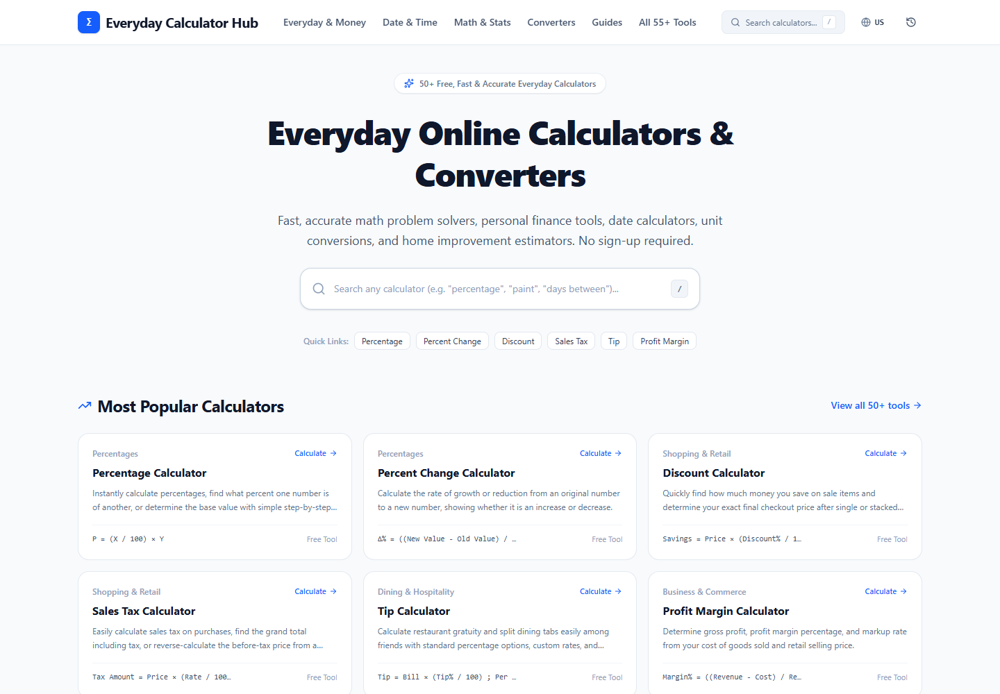
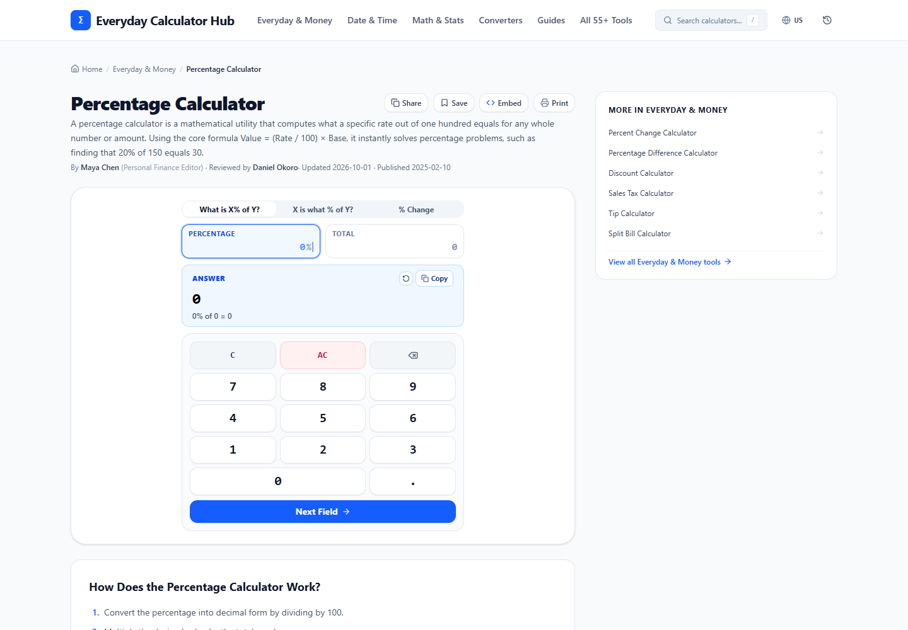
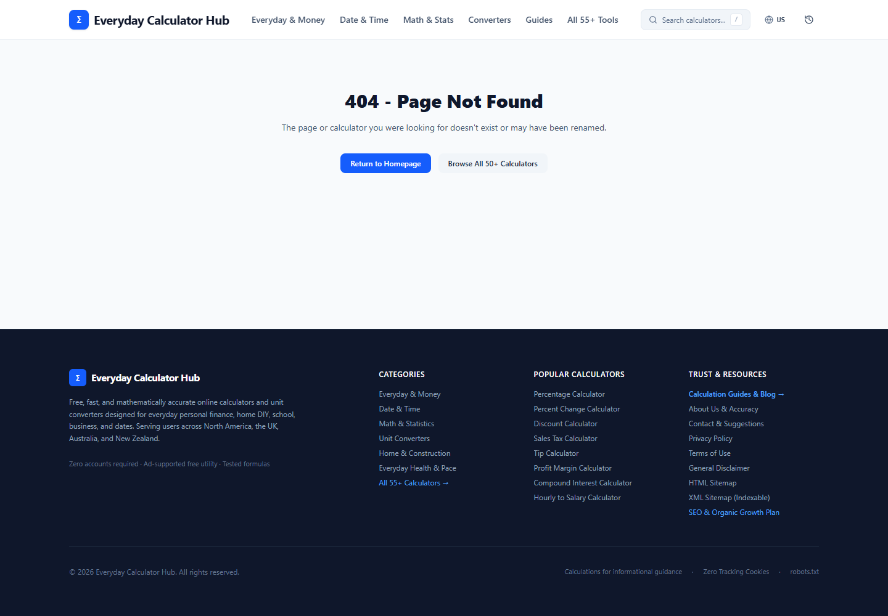
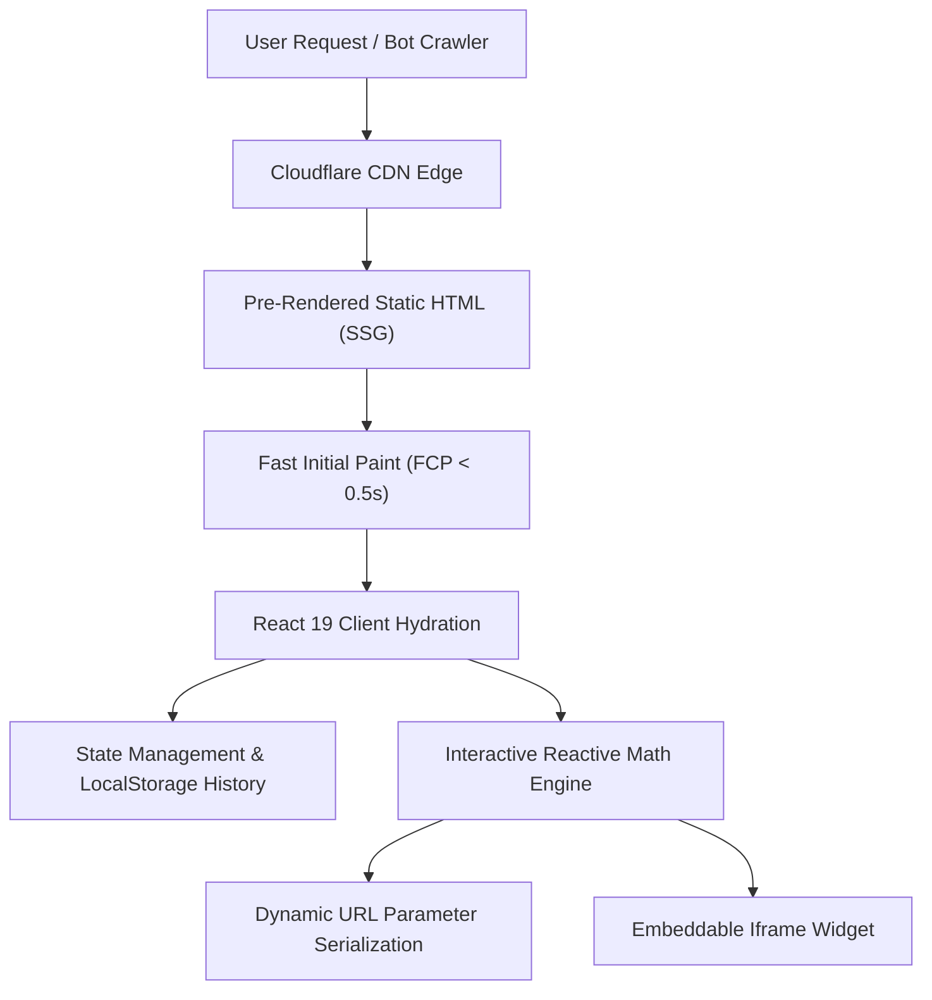

<div align="center">

# 🧮 Everyday Calculator Hub

**A blazing-fast, technical SEO-engineered online calculation platform featuring 55+ precision calculators, converters, and editorial guides.**

[](https://everyday-calculator-hub-cw8.pages.dev/)
[](https://github.com/britsync07-prog/everyday-calculator-hub/stargazers)
[](LICENSE)
[](tests/)
[](https://www.typescriptlang.org/)
[](https://react.dev/)
[](https://tailwindcss.com/)

<p align="center">
  <a href="#-live-demo">Live Demo</a> •
  <a href="#-visual-showcase">Screenshots</a> •
  <a href="#-behind-the-build-the-solo-developer-journey">The Solo Dev Story</a> •
  <a href="#-key-features">Key Features</a> •
  <a href="#-architecture">Architecture</a> •
  <a href="#-quick-start">Quick Start</a> •
  <a href="#-author">Author</a>
</p>

</div>

---

## 🌐 Live Demo

Experience the lightning-fast, zero-CLS performance live on Cloudflare Pages:
👉 **[https://everyday-calculator-hub-cw8.pages.dev](https://everyday-calculator-hub-cw8.pages.dev)**

---

## 📸 Visual Showcase

| Home Experience & Instant Search | Interactive Calculator & Presets |
| :---: | :---: |
|  |  |

| Complete 55+ Tool Directory | In-Depth Authoritative Guides & Formulas |
| :---: | :---: |
|  |  |

| Mobile-First Responsive Precision |
| :---: |
|  |

---

## 👨‍💻 Behind the Build: The Solo Developer Journey

> *"Most online calculators are relics of the early 2000s: sluggish, infested with jarring layout-shifting banner ads, and built with bloated frameworks that sacrifice user experience for ad impressions. As an independent solo software engineer, I wanted to prove that a modern, zero-CLS, statically pre-rendered platform could dominate search results while giving users instant, beautiful calculations."*  
> — **Musfiqur Rahman Saimon** ([@britsync07-prog](https://github.com/britsync07-prog))

I am **Musfiqur Rahman Saimon**, an individual full-stack developer (not an agency, company, or team). Building **Everyday Calculator Hub** end-to-end as a solo creator meant tackling complex algorithmic, architectural, and search optimization hurdles without a team to delegate to. 

Here are the real problems I faced and the engineering solutions I implemented:

### 1. The Competitor's SSG Advantage vs. Client-Side SPAs
- **The Problem:** Established competitors (such as `everydaycalchub.com`) ran on server-rendered Next.js stacks, serving pre-baked HTML to Googlebot. Traditional React Single Page Applications (SPAs) deliver an empty `<div id="root"></div>`, forcing search engines to wait for JavaScript execution and hurting long-tail SEO crawl budgets.
- **How I Tackled It:** Rather than switching to a heavy node-server runtime, I authored a custom Static Site Generation (SSG) pipeline ([`scripts/prerender.ts`](scripts/prerender.ts)) using Node.js and React 19's `renderToString`. Following `vite build`, the script crawls every single route—homepage, 55 calculator tools, category hubs, programmatic landing pages, and blog posts—baking full HTML with complete OpenGraph metadata, structured JSON-LD, and semantic breadcrumbs. Search crawlers receive 100% pre-rendered DOM instantly, and React hydrates cleanly in the browser.

### 2. High Ad Revenue Without Layout Shifts (Zero-CLS Architecture)
- **The Problem:** Calculators are traditionally monetized through display banners, but dynamic ad injections cause terrible Cumulative Layout Shift (CLS), frustrating users and triggering Google PageSpeed ranking penalties.
- **How I Tackled It:** I built an ad-container engine ([`src/components/AdSlot.tsx`](src/components/AdSlot.tsx)) with strict hardware-accelerated CSS dimensions and responsive aspect ratios reserved upfront. Advertisements load within deterministic slots with zero layout shift (CLS = 0.000). I also created a toggleable "Ad Preview Mode" that webmasters can use to inspect ad placements locally.

### 3. Floating-Point Precision & Multi-Locale Currency/Unit Standards
- **The Problem:** JavaScript's IEEE 754 floating-point arithmetic famously produces quirks like `0.1 + 0.2 = 0.30000000000000004`. In financial and engineering calculators, inaccurate decimal rounding destroys user trust. Furthermore, Tier-1 countries format currency, dates, and measurement units differently (e.g., US uses Imperial & MM/DD/YYYY, UK uses GBP & DD/MM/YYYY, AU/CA use Metric).
- **How I Tackled It:** I built a robust math formatting library ([`src/utils/formatters.ts`](src/utils/formatters.ts)) with automated test suites that eliminate floating-point noise. Then, I engineered a global locale context that dynamically switches number separators, currencies (USD, GBP, CAD, AUD), date formats, and unit systems across the entire application with zero latency.

### 4. Viral Growth: Shareable Calculation States & Embeddable Widgets
- **The Problem:** Getting organic backlinks for utility websites is notoriously difficult.
- **How I Tackled It:** 
  1. **Dynamic URL Query State:** Every calculation automatically serializes its inputs into the URL (e.g., `?amount=25000&rate=6.5&years=5`), allowing users to bookmark or share exact calculations with one click.
  2. **Interactive Embed Generator:** I built an "Embed This Tool" modal ([`src/components/EmbedCalculatorModal.tsx`](src/components/EmbedCalculatorModal.tsx)) that provides webmasters with an ultra-light responsive `<iframe>` code snippet, driving high-authority editorial backlinks.

---

## ⚡ Key Features

- **55+ Production-Ready Calculators Across 6 High-Intent Pillars:**
  - **💰 Money & Everyday Finance:** Percentage, Percent Difference, Discount, Sales Tax, Tip & Split Bill, Profit Margin, Markup, Commission, Simple Interest, Compound Interest, Salary/Hourly Converters.
  - **📅 Date, Time & Calendars:** Days Between Dates, Date Difference, Business Days, Duration, Live Countdown, Time Zone Planner.
  - **📐 Math & Statistics:** Scientific Keypad Solver, Fraction Simplifier, Ratio & Proportion, Square Roots, Exponents, LCM & GCD, Mean/Median/Mode, Standard Deviation, Prime Factors.
  - **🔄 Unit Converters:** Length, Weight/Mass, Temperature, Area, Volume, Speed, Data Storage, Pressure, Fuel Economy, Oven Cooking Converter.
  - **🏡 Home, DIY & Construction:** Room Square Footage, Paint Gallons, Flooring Boxes (with 10% waste buffer), Tile Estimator, Concrete Slab & Footing, Mulch & Gravel Volume.
  - **🏃 Fitness & Pacing:** Running Pace, Walking Steps to Calories & Distance, Daily Hydration Intake, BMI Body Metrics.
- **Technical SEO First:**
  - Complete Schema.org JSON-LD structured data (`WebApplication`, `FAQPage`, `BreadcrumbList`, `BlogPosting`).
  - Automated XML sitemaps, robots.txt, and HTML crawler sitemaps.
  - Canonical trailing-slash route normalization for Cloudflare Pages edge delivery.
- **Zero-Latency Client-Side Storage:**
  - Local history drawer powered by HTML5 `localStorage`—no login required, 100% private.
  - Instant keyboard command palette search (`/` shortcut).
  - Print-optimized stylesheets (`@media print`) for clean paper or PDF calculation exports.

---

## 🏗️ Architecture & Data Flow



---

## 📁 Repository Structure

```text
everyday-calculator-hub/
├── assets/
│   └── screenshots/         # High-resolution application UI screenshots
├── public/
│   ├── _redirects           # Cloudflare Pages SPA routing rules
│   ├── robots.txt           # Search crawler directives
│   └── sitemap.xml          # Canonical XML index of all 55+ tools
├── scripts/
│   └── prerender.ts         # Static pre-rendering (SSG) crawler
├── src/
│   ├── components/          # Reusable UI, AdSlots, Breadcrumbs & Header
│   ├── data/                # 55+ calculator definitions, formulas, and guides
│   ├── pages/               # Route views (Home, Calculator, Category, Blog, Trust)
│   ├── types/               # TypeScript data models and schema definitions
│   └── utils/               # Math formatters, SEO metadata generator, history
├── tests/                   # Automated Node.js verification test suite
├── package.json             # Scripts, dependencies, and project metadata
├── tsconfig.json            # Strict TypeScript configuration
└── vite.config.ts           # Vite build configuration
```

---

## 🚀 Quick Start

### Prerequisites
- Node.js version 20 or higher
- npm or bun

### 1. Clone & Install
```bash
git clone https://github.com/britsync07-prog/everyday-calculator-hub.git
cd everyday-calculator-hub
npm install
```

### 2. Development Server
```bash
npm run dev
```
Visit `http://localhost:3000` in your browser.

### 3. Run Test Suite
```bash
npm test
```
Runs the automated test suite verifying calculator accuracy, category uniqueness, programmatic slugs, and SEO schema helpers.

### 4. Build for Production (SSG)
```bash
npm run build:ssg
```
Builds the client assets via Vite and executes `prerender.ts` to output static HTML files into `dist/`.

---

## 🤝 Contributing

Contributions, feedback, and calculator suggestions are welcome!
- Check out [CONTRIBUTING.md](CONTRIBUTING.md) to get started.
- Review our [Code of Conduct](CODE_OF_CONDUCT.md).
- Submit feature requests or bug reports via GitHub Issues.

---

## 👤 Author

**Musfiqur Rahman Saimon**
- 🐙 GitHub: [@britsync07-prog](https://github.com/britsync07-prog)
- 💼 Independent Full-Stack Engineer & Open-Source Creator

⭐ **If you found this project helpful or inspiring, please give it a star on GitHub! It means the world to independent developers.** ⭐

---

## 📄 License

This project is licensed under the [MIT License](LICENSE) - Copyright (c) 2026 Musfiqur Rahman Saimon.
